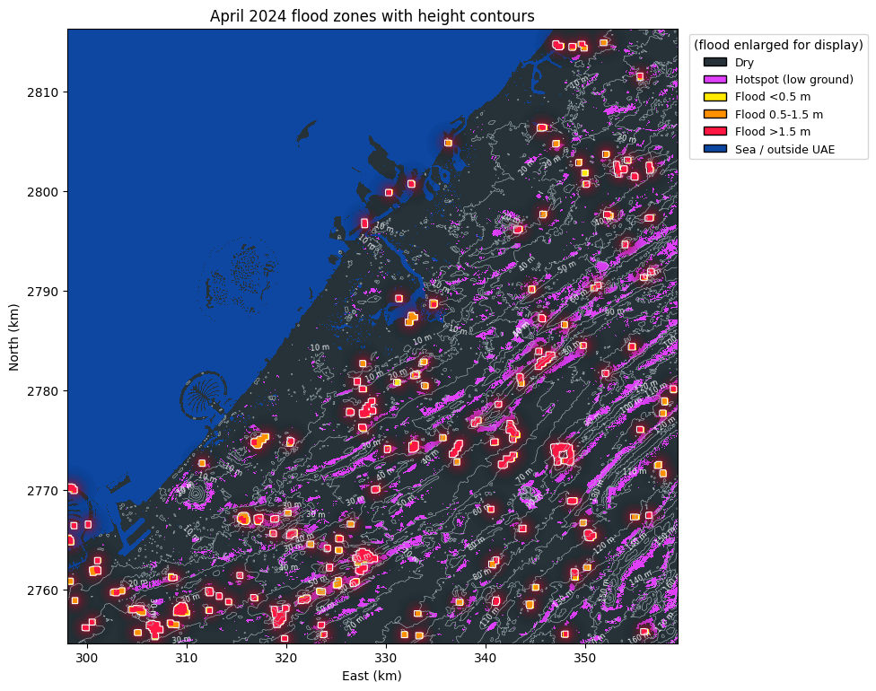
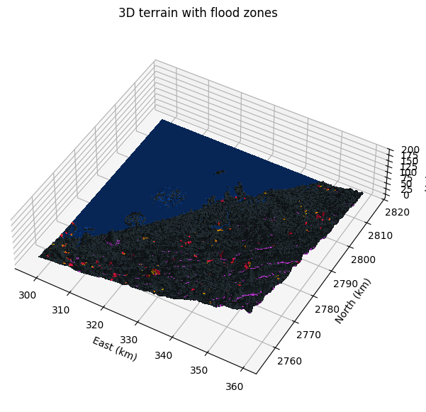
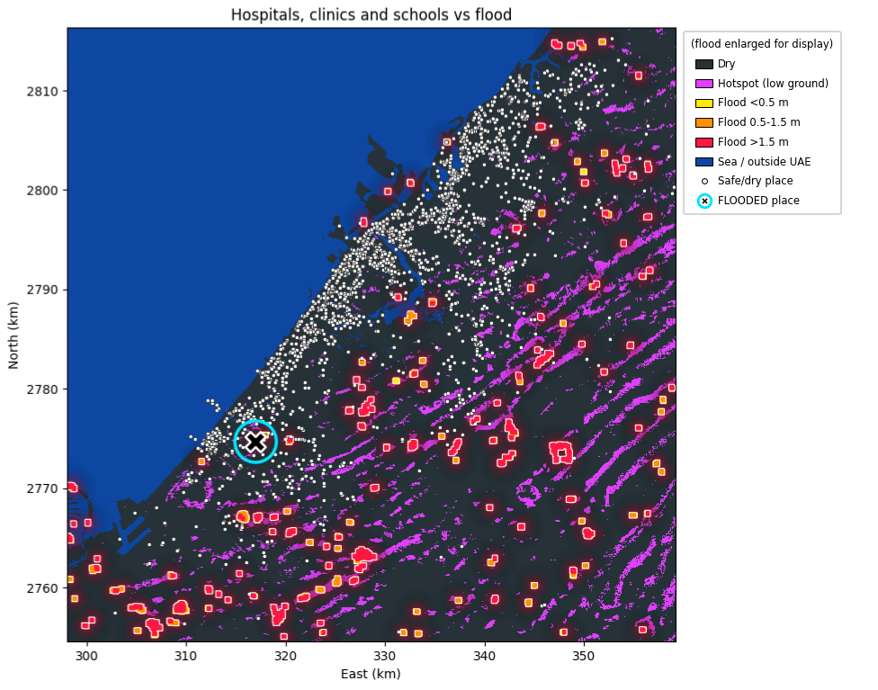
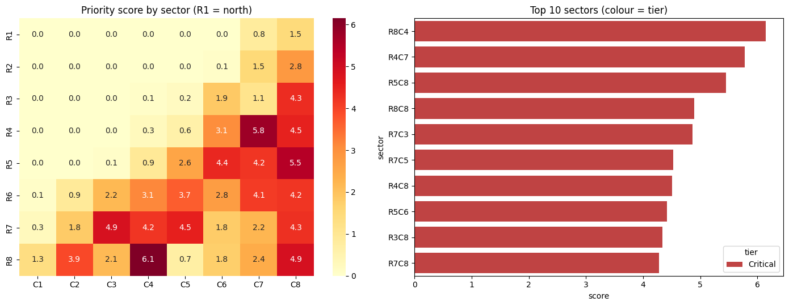

# UAE Flood Response: Satellite-Based Flood Mapping and First-Responder Planning

**WSW 2026 Hackathon, BPDC Supernova | Data/software prototype**
**Team:** Kestrel

> Terrain alone predicts where the April 2024 UAE flood happened 2.6x to 3.6x better than random, and our pipeline turns that into a ranked first-responder plan.

## Why it matters
Responders can see where to go first within hours of a satellite pass, instead of waiting days for ground reports. The notebook turns raw radar and terrain data into a ranked list of sectors, the places at risk, and a suggested lead team.

## Results at a glance
**Flood zones with height contours.** Red, orange and yellow show deep, medium and shallow flooding. Purple shows terrain-based hotspots (low, flat ground).

**3D terrain with flood zones.** The same colour code on a 3D surface shows how flooding collects in low-lying ground.

**Hospitals, clinics and schools against the flood.** White dots are dry places. The ringed cross marks a school inside the flood zone.

**Sector priority.** The study area is split into an 8 x 8 grid, and each sector is scored for response priority.

## Alignment with the problem statement (Theme 4: First Responders from Orbit)
- **Map floods within hours, not days:** Covered. Sentinel-1 radar flood mapping from a before/after pair, with depth zones.
- **Learn from the April 2024 UAE floods:** Covered. We reconstruct where water pooled, how deep it was, and which areas were most exposed, using terrain hotspots validated against the real flood.
- **Assess damage to roads and buildings:** Partly covered. We flag flooded hospitals, clinics and schools. Road-access analysis is planned future work.

## Problem
In April 2024, record rainfall flooded Dubai, Sharjah and Ajman. Responders (SDRF/NDRF-style teams) needed to know **where the water was, how deep it was, which hospitals and schools were affected, and where to send teams first**. Ground reports were slow and incomplete. Satellites can see the whole region at once, even through clouds.

## Our solution
A single Google Colab notebook (`krestel.ipynb`) that turns free satellite data into a first-responder action plan:

1. **Flood mapping.** Sentinel-1 radar images from before and after the event (same orbit and direction) are compared. A pixel is flood if it got much darker (change < -3 dB) AND is now dark (< -15 dB). We remove permanent water (JRC Global Surface Water), steep slopes (> 5 degrees, Copernicus DEM) and tiny specks, and clip to the UAE border.
2. **Depth zones.** The water level is estimated as the 90th percentile of flooded ground height within 1 km. Subtracting ground height gives rough depth zones: shallow (< 0.5 m), medium (0.5-1.5 m), deep (> 1.5 m).
3. **Pre-flood hotspots.** Low, flat ground that sits below its surroundings is flagged as a flood hotspot. We then test how much of the real flood fell inside those hotspots, as a "predict before it happens" check.
4. **Maps and plots.** Colour-coded 2D zone map with height contours, an optional 3D terrain view, and interactive Earth Engine maps.
5. **Places at risk.** About 4,000 hospitals, clinics and schools (Overture Maps) are checked against the zone map.
6. **Action plan.** The area is split into an 8 x 8 sector grid. Each sector gets a priority score and a tier (Critical / High / Moderate / Low). The plan also suggests a dry staging point and whether SDRF or NDRF should lead (NDRF if deep water is a large share).

## Key results (study area: Dubai-Sharjah-Ajman)
- **Flooded area detected:** 8.7 km2
- **Depth zones:**
  - Shallow (< 0.5 m): 2.09 km2
  - Medium (0.5-1.5 m): 2.23 km2
  - Deep (> 1.5 m): 4.35 km2
- **Hotspot check (terrain-only flood prediction):**
  - -3 m threshold: flags 8.3% of land and captures 21.6% of the flood (**2.6x better than random**)
  - -5 m threshold: flags 2.0% of land and captures 7.3% of the flood (**3.6x better than random**)
- **Places scanned:** 4,065 hospitals, clinics and schools

## Tech stack
Python, Google Earth Engine (Sentinel-1 GRD, Copernicus GLO-30 DEM, JRC Global Surface Water, LSIB borders), geemap, rasterio, NumPy, pandas, SciPy, Matplotlib, Seaborn, GeoPandas, Overture Maps. Runs on Google Colab.

## How to run
1. Open `krestel.ipynb` in [Google Colab](https://colab.research.google.com/) (File > Upload notebook, or Open from GitHub).
2. Get a free Earth Engine project at <https://code.earthengine.google.com/register>.
3. In **Cell 2**, set `PROJECT_ID` to your own Earth Engine project ID.
4. Run cells top to bottom. A login pop-up appears once. Sign in with the same Google account you used for Earth Engine.
5. Total runtime is about 15-20 minutes. The notebook already contains saved outputs, so you can read it without running anything.

Settings you can tune are marked `<-- CHANGE THIS` in the notebook (orbit, dates, flood thresholds, hotspot radius, sector grid size).

## Limitations and future work
- Depth is a rough estimate from terrain and is meant for zones, not exact depths.
- Radar can miss flood water under dense buildings, and smooth sand can look like water. We reduce this with two rules and slope and permanent-water masks, but there is no ground-truth validation yet.
- Sector scores use weights we chose (flood km2 + 3 x deep + 1.5 x medium + 0.5 x hotspot + 0.5 x flooded places).
- The flood mask keeps only high-confidence pixels, so the real flooded extent is likely larger than the 8.7 km2 reported.
- Roads were skipped because they are heavy to download. Road-access analysis is the next step.

## Files
- `krestel.ipynb`: the full pipeline with outputs
- `images/`: result figures used in this README
- `requirements.txt`: Python libraries (Colab already has most of them)
